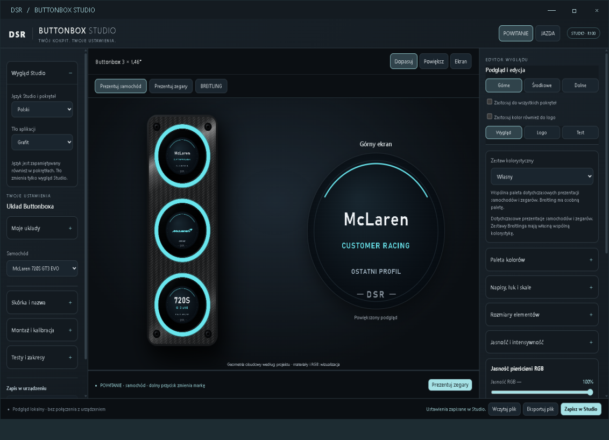

# DSRacing Buttonbox Studio

Aplikacja Windows do Buttonboxa z trzema panelami 1,46″. To repozytorium udostępnia **instalatory i instrukcje**. Kod źródłowy projektu i prywatne profile użytkownika nie są publikowane.

## Pobierz i zainstaluj

**[Pobierz instalator DSRacing Studio](https://github.com/dareksteuer/dsracing-studio-releases/releases/latest/download/DSRacingStudio-Setup.exe)**

1. Pobierz plik, zamknij działające Studio i uruchom instalator.
2. Wybierz język: polski, niemiecki lub angielski, następnie **Zainstaluj**.
3. Po instalacji uruchom Studio ze skrótu na pulpicie lub w menu Start.

Link pobiera plik. Przeglądarka i Windows wymagają samodzielnego uruchomienia instalatora; nie jest to instalacja bez zgody użytkownika.

## Wydanie R105

R105 dodaje aktualizacje Studio i zachowuje dotychczasowe funkcje, ustawienia oraz obsługę trzech USB. Firmware paneli nie jest częścią aktualizacji.

- Studio sprawdza dostępność nowej wersji raz po uruchomieniu i informuje przyciskiem na dolnym pasku.
- **O programie i aktualizacje**: wersja programu, opis wydania, ręczne sprawdzenie oraz **Pobierz i zainstaluj**.
- Pobieranie rozpoczyna się wyłącznie po kliknięciu. Po weryfikacji rozmiaru i SHA-256 Studio zamyka się normalnie, a instalator czeka na zakończenie jego pracy.
- Brak internetu nie blokuje Studio. Brak okresowego sprawdzania i instalacji w tle.
- Pierwsze przejście z R102 do R105: pobierz instalator z powyższego linku i zainstaluj go ręcznie. Funkcja aktualizacji jest dostępna dopiero od R105.

- Instalacja dla bieżącego użytkownika do `%LOCALAPPDATA%\DSR\ButtonboxStudio`.
- Wykrywanie Microsoft WebView2 i instalacja brakującego składnika z oficjalnego pakietu Microsoft.
- Skróty na pulpicie i w menu Start; wpis do odinstalowania w ustawieniach Windows.
- Zachowanie danych w folderze `Dane`, kopia zastępowanych plików i wycofanie zmian przy błędzie kopiowania.
- Pomocnik czasu R074: uruchamiany przy logowaniu do Windows, bez okresowych korekt zegarów.
- Instalator **nie wgrywa firmware** i nie konfiguruje SimHuba. Mostek DLL jest dołączony do osobnej integracji.
- Eksperymentalne paczki RS485/DS3231 nie są udostępniane w tym wydaniu.

## Wymagania i weryfikacja

Windows 10/11, .NET Framework 4.6.2 lub nowszy (zalecany 4.8), Microsoft WebView2. Jeśli WebView2 nie jest zainstalowany, potrzebny jest internet.

Instalator nie ma komercyjnego podpisu cyfrowego. Windows może ostrzec o nieznanym wydawcy. Nie wyłączaj ochrony systemu; w razie blokady zachowaj dokładny komunikat. Suma SHA256 znajduje się w plikach wydania.

Sprawdzone lokalnie: 56 kontroli instalacji, zachowania profili, kopii, cofania zmian, skrótów i uruchomienia; 72 kombinacje języka, tła i trybu w natywnym WebView2. Dodatkowo: 28 kontroli mechanizmu aktualizacji oraz okno PL/DE/EN. Użytkownik potwierdził instalację R102 i podstawowe działanie paneli przez hub na drugim komputerze. Test R105 na drugim komputerze oraz instalacja na systemie bez WebView2 pozostają do wykonania. Nie wykonano nowego testu USB ani gry w ramach tej paczki.

Dziennik instalacji: `%TEMP%\DSRacing-Setup-*.log`. Dane i poprzednie wersje są zachowywane również przy odinstalowaniu.

## Prezentacja Buttonboxa

Trzy okrągłe ekrany, wspólna kolorystyka i osobne ustawienia czytelności. Studio obsługuje prezentacje samochodów, zegarki, stoper oraz tryby STANDART i Breitling Racing. Interfejs i komunikaty paneli mają wybór języka polskiego, niemieckiego i angielskiego. Podgląd odwzorowuje projekt z matowym czarnym aluminium i błyszczącą maskownicą z karbonu.

Zrzut pokazuje rzeczywisty interfejs w podglądzie lokalnym. Ostateczne złożenie obudowy i testy nowej komunikacji RS485 oraz zegara DS3231 pozostają w toku; nie są potwierdzonymi funkcjami tej paczki instalacyjnej.

## Dokumentacja techniczna i dostęp

Instalator oraz ta prezentacja są publiczne. Modele Fusion, pliki produkcyjne, schematy i pełna broszura znajdują się w osobnym prywatnym repozytorium, udostępnianym indywidualnie po zgodzie właściciela. Kod źródłowy pozostaje niepubliczny. W sprawie dostępu można otworzyć zgłoszenie w tym repozytorium, podając nazwę konta GitHub — bez prywatnych danych i załączników technicznych.

## Deutsch

[Windows-Installer herunterladen](https://github.com/dareksteuer/dsracing-studio-releases/releases/latest/download/DSRacingStudio-Setup.exe). Datei öffnen, Sprache wählen und installieren. Studio vorher schließen. Fehlendes WebView2 wird mit Internetzugang installiert. Profile bleiben erhalten. Keine Firmware-Aktualisierung; SimHub wird separat eingerichtet. Updates werden einmal beim Start geprüft. Download und Installation nur per Klick unter „Info und Updates“. Beim ersten Wechsel von R102 auf R105 den Installer manuell herunterladen. Das Programm ist nicht digital signiert.

## English

[Download the Windows installer](https://github.com/dareksteuer/dsracing-studio-releases/releases/latest/download/DSRacingStudio-Setup.exe). Open the downloaded file, choose a language and install. Close Studio first. Missing WebView2 is installed using Microsoft's bootstrapper and requires internet. Existing profiles are preserved. No firmware flashing; SimHub setup is separate. Updates are checked once at startup. Download and install only by clicking in “About and updates”. The initial upgrade from R102 to R105 requires a manual download. The installer is not digitally signed.

---

Zasoby interfejsu są częścią programu. Dystrybucja binarna nie zapobiega analizie ani odtwarzaniu jego działania. Znaki marek należą do ich właścicieli; aplikacja nie deklaruje współpracy z nimi.

[Dokumentacja Microsoft WebView2](https://learn.microsoft.com/en-us/microsoft-edge/webview2/concepts/distribution)
